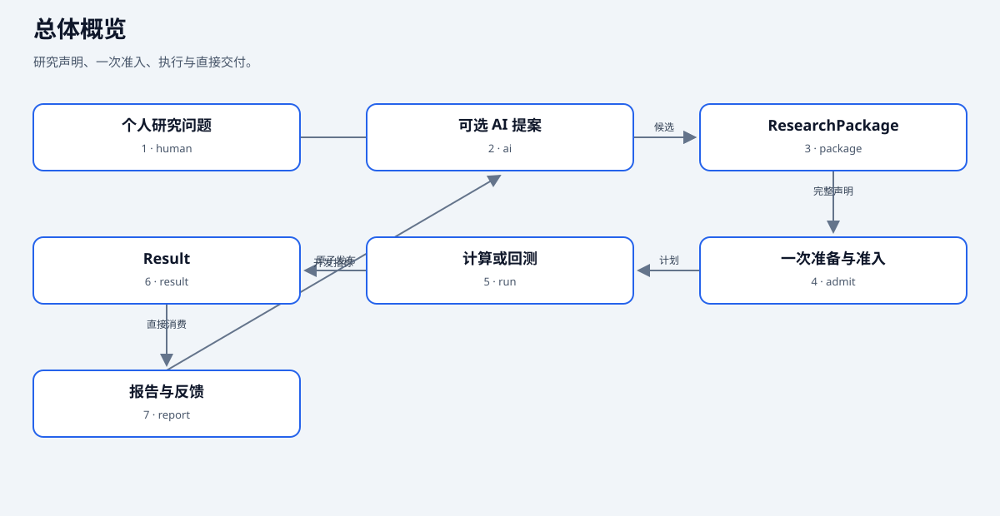

# QuantWitness

QuantWitness 是量化研究与回测框架。你提供数据、计算方法和评价范围。框架检查数据时点，执行计算，保存正式结果。

当前源码版本为 **1.6.0**。发布状态见 [Releases](https://github.com/ljjtim/QuantWitness/releases)。

第一次使用，从[换手率因子入门](docs/workspace-quickstart.md)开始。教程采用合成数据，不需要行情账号或个人数据库。

[入门教程](docs/workspace-quickstart.md) · [文档导航](docs/index.md) · [接入数据](docs/catalog.md) · [模型研究](docs/walk_forward_model.md) · [交易回测](docs/lean-execution.md) · [AI研究](integrations/rdagent/README.md)

## 能完成什么

| 目标 | 使用的组件 | 起点 |
| --- | --- | --- |
| 检验因子、分组收益和统计指标 | 项目算法与正式结果 | [换手率示例](examples/turnover_factor/README.md) |
| 训练日频模型并滚动评价 | Qlib与框架的样本边界 | [模型教程](docs/walk_forward_model.md) |
| 使用已训练模型继续预测 | 显式模型输入 | [模型导入](docs/completed-model-input.md) |
| 回测股票、ETF和期货策略 | 本地LEAN引擎 | [首次回测](examples/lean_quickstart/README.md) |
| 让AI提出因子或模型候选 | 可选RD-Agent集成 | [安装与配置](integrations/rdagent/docs/installation.md) |
| 查看、比较和导出结果 | Result结果接口 | [结果文档](docs/evidence.md) |
| 中断后继续研究 | 事件与检查点 | [恢复文档](docs/runtime.md) |

特定因子公式、资产池和参数属于研究项目。框架通过项目扩展读取这些声明。

## 获取与安装

完整源码包含教程、示例和可选集成。Python安装包只包含运行程序和包资源。

1. 获取公开源码。

```powershell
git clone https://github.com/ljjtim/QuantWitness.git
cd QuantWitness
```

2. 创建Python虚拟环境。

```powershell
python -m venv .venv
.\.venv\Scripts\Activate.ps1
python -m pip install --upgrade pip
python -m pip install ".[dev]" "pyarrow==21.0.0"
```

Linux或macOS使用 `source .venv/bin/activate` 激活环境。后续Python命令相同。

3. 查看命令帮助。

```powershell
python -m research_pipeline --help
python -m research_pipeline capabilities --format json
```

4. 运行第一项研究。

```powershell
python examples/turnover_factor/run.py --output ../quantwitness-work/turnover-first
```

输出目录必须尚不存在。成功后，打开输出目录中的 `report.md`。完整步骤见[入门教程](docs/workspace-quickstart.md)。

## 按功能准备环境

| 功能 | 安装方式 | 外部条件 |
| --- | --- | --- |
| 因子统计与结果报告 | 核心包 | Python不低于3.10，自有数据或合成输入 |
| Qlib表格模型 | `python -m pip install ".[ml]"` | Qlib 0.9.7及声明的模型依赖 |
| Qlib序列和图模型 | `python -m pip install ".[ml,ml-sequence]"` | Torch 2.9.1，CPU或兼容的CUDA设备 |
| LEAN日线与一分钟回测 | [LEAN安装步骤](integrations/lean/README.md) | Windows x64、PowerShell 7、完整源码或源码包 |
| RD-Agent研究循环 | [RD-Agent安装步骤](integrations/rdagent/docs/installation.md) | 独立Linux环境、上游固定源码和模型服务配置 |

完整源码提供全部当前功能的代码。模型、LEAN和RD-Agent需要各自的运行环境。行情授权、数据和模型服务密钥由使用者准备。

## 一次研究怎样完成

1. 声明研究问题、数据、算法和指标。
2. 检查数据来源和可见时间。
3. 执行计算或交易回测。
4. 发布正式结果Result。
5. 读取结果生成报告或比较实验。

研究包（ResearchPackage）保存第1步的声明。工作区（Workspace）保存实验记录。结果包（Result）保存正式表和来源引用。

[](https://ljjtim.github.io/QuantWitness/index.html)

[在线图册](https://ljjtim.github.io/QuantWitness/index.html)提供6种视角。离线入口为 `docs/architecture/index.html`。

`workspace execute` 合并准备、准入、执行和报告。独立 `package lint` 用于定位声明错误。`package init` 只生成草稿，填写完整后才能运行。

## 数据和结果规则

- 框架只读访问研究数据库。
- 历史计算只使用当时已知的信息，称为PIT规则。
- 特征、标签、成分股和财报按可见时间对齐。
- 最终留出集独立于开发循环，消费记录长期保存。
- 查询输入默认保存来源引用。`--persist-inputs` 另存输入副本。
- 恢复前核对输入、实现、配置和检查点。
- 报告读取Result，不重新训练或回测。
- 清理时保留Result、模型和它们引用的输入。

项目算法通过[扩展包](EXTENSIONS.md)接入。自定义指标见[指标示例](examples/custom_metric/README.md)。内存、进程和临时空间限制见[资源预算](docs/project_resource_budgets.md)。

## 当前支持范围

交易策略使用日线或一分钟行情。股票、ETF和人民币期货按已准入规则执行。期货支持共享资金、多空今昨仓、结算和换月。

期权、完整融券、组合保证金优惠和实物交割未纳入通用能力。市场、合约和日期必须具备声明需要的数据及历史规则。

框架只支持当前合同，不自动迁移旧计划或检查点。升级后，按当前版本重新准入。历史结果及其依赖继续保留。

合成示例用于学习和检验计算流程。合成收益不代表投资表现。`local_only` 表示已记录的本地适用范围。

<details>
<summary>机器清单中的能力状态</summary>

<!-- CAPABILITIES_TABLE:START -->

| capability | 状态 | 命令 | 证据 / 信任 | 边界说明 |
| --- | --- | --- | --- | --- |
| `catalog.lock` | `local_only` | `catalog` | `local_acceptance` / `local_only` | Catalog 编译、锁定和漂移检查由显式来源文件驱动；公开仓库不附带个人 Catalog 或独立发布验收记录。 |
| `research_package.plan` | `local_only` | `package lint`<br>`package admit` | `local_acceptance` / `local_only` | ResearchPackage 只能声明受控合同，不接受自由 SQL、动态模块或项目 runner。lint 一次返回声明、算子、指标、结果和准入缺口；admit 从显式只读数据源生成漂移/PIT 闭包并在发布/加载时校验准入事实。 |
| `runtime.recovery` | `local_only` | `resume`<br>`retry-node`<br>`inspect`<br>`rerun-from`<br>`run --reuse-run-root`<br>`run --require-reused-node`<br>`run --reuse-failed-run-root`<br>`workspace run --reuse-run-root`<br>`workspace run --require-reused-node`<br>`workspace run --reuse-failed-run-root` | `local_acceptance` / `local_only` | resume、retry-node、inspect 和 rerun-from 消费当前 invocation、计划内算子闭包和已验证 checkpoint；run 与 workspace run 共用复用参数和正式运行校验；--reuse-run-root 只按显式顺序接受现行节点局部身份下已成功发布 Result 的完成态 run，并机会式复用 pure/cacheable 节点。配合 --require-reused-node 时，指定节点及其必要上游允许不是 pure/cacheable，但必须在 Worker 启动前全部通过节点局部身份、输入、checkpoint、typed 输出和 ExternalArtifact 内容复验，且不得回退执行。run --reuse-failed-run-root 只接受一个显式失败终态 run，要求新旧 DAG、节点身份环境、clock 和 seed 完全一致，只把状态为成功且完整复验通过的 checkpoint 复制进目标 run，再从首个未成功节点继续。两种跨运行来源不能混用，不扫描磁盘或依赖裸 ResultStore。同一次 execute 复用 Supervisor 已冻结的工件验证结果，新的 resume 进程、rerun child 或新 run 必须重新完整验证。多请求 data 节点另以 run 内 partial index 逐项复验已提交 DatasetArtifactRef，只重做失效 request；partial 不进入正式输出。恢复与跨运行复用均使用当前合同和已冻结的输入、实现及配置身份。该边界仍为 local_only。 |
| `result.consume` | `local_only` | `report`<br>`export-result`<br>`compare`<br>`analysis run`<br>`analysis compare` | `local_acceptance` / `local_only` | report、compare、analysis、export-result 和 Dashboard 直接消费正式 Result，不依赖 run-root。报告只投影需要的表与列。analysis 的请求显式声明窗口、值语义、单位、费用和处理政策；只有规格与实际窗口相同的结果才能排名。package compare 另检查研究包的指标与结论合同。Result 中的结论级别是研究声明及输入范围，不是独立认证。 |
| `operator_graph.generic_run` | `local_only` | `run`<br>`resume`<br>`retry-node`<br>`inspect` | `local_acceptance` / `local_only` | 正式 run 由统一 Runtime 调度，节点返回按端口索引的类型化工件，checkpoint 绑定全部端口；成功后原子发布 Result，报告与开发反馈直接读取结果。恢复继续核对输入、配置、实现和检查点，失败不能作为成功研究反馈。当前范围保持 local_only。 |
| `research.walk_forward_model` | `local_only` | `package admit`<br>`run` | `local_acceptance` / `local_only` | Qlib 六节点负责日频回归模型：Linear、LightGBM、XGBoost；Processor 与 Model 按候选/fold 一起训练保存。保留 purge/embargo、开发区 validation 选择及隔离 holdout；模型文件随 Result 封存。模型工件与处理器一同冻结，恢复要求输入、模型与处理器身份一致。本地技术验收不代表真实策略、可交易性或样本外盈利。 |
| `minute_line.complete` | `local_only` | `run` | `local_acceptance` / `local_only` | 股票与ETF的一分钟策略使用LEAN原生订单与账户，按已准入来源、完成bar和历史可见规则执行。读取层按月整理、按天消费并预读下一交易日；预读不改变策略可见时点。日线使用独立开盘来源。当前策略频率为1m或1d，能力保持local_only。 |
| `minute_line.real_data_smoke` | `local_only` | `run` | `local_acceptance` / `local_only` | 公开包提供四资产分钟输入和只读 Result 合同，不附带供应商原始数据或个人运行记录。真实数据观察由使用者在自己的来源、窗口和规则下执行；当前能力为 local_only，不代表供应商历史版本精确重放或分钟交易仿真。 |
| `simulation.bar_tca` | `local_only` | `capabilities --format json` | `local_acceptance` / `local_only` | Bar TCA 提供库级成交成本归因，消费调用方提供的正式订单、成交、可见价格基准和政策，不重新撮合。当前没有主 DAG 算子或 Result 报告入口；缺少正式成交或必要可见事实时拒绝计算。 |
| `capability.discovery` | `local_only` | `capabilities --format json`<br>`operator list/describe/scaffold/validate/build`<br>`artifact describe`<br>`recipe list/describe/scaffold`<br>`catalog dataset/field search`<br>`package lint`<br>`package expand-variants` | `local_acceptance` / `local_only` | capabilities 命令逐字段读取本清单；operator、artifact、catalog 和 package lint 的发现结果来自正式 registry、schema、Catalog Lock 或 package compiler。package expand-variants 只覆盖基包中已存在的 node 参数，原子生成普通完整包，不接受深层 YAML 合并、模板、Python 或 SQL。当前没有获准的公共 recipe，使用 package init 创建通用起点；项目完整拓扑由 ResearchPackage 声明。operator scaffold 生成可验证的最小项目算子；正式 Feature/Label 需必填 causal_plan，且来源必须可由已准入请求证明。validate/build 只复验显式源码闭包，不扫描目录或自动安装。 |
| `resource.governance` | `local_only` | `run --resource-state-dir` | `local_acceptance` / `local_only` | 数据节点预算先编译为 DuckDB、batch/writer 与进程余量；当前 provider 支持包络下限为 256 MiB，低于下限在对象统计和扫描前拒绝。完整矩阵消费者用 footer 做数据页前的明显超界拒绝；内部 worker 默认 1 个，显式指定不能超过 CPU 或 max_workers 容量，并共用节点总预算。全新隔离进程中的真实 DuckDB/Parquet/Arrow 探针回归整个进程树 RSS、读取量与 temp 峰值，不把局部公式称为任意 allocator 的硬上界。多个 CLI/worker 的 FIFO 租约与父子令牌仍共用总容量；资源不足不改变样本、频率、参数或 seed。合成探针不进入正式运行校准总体。 |

<!-- CAPABILITIES_TABLE:END -->

</details>

## 深入使用

- [创建自己的研究](docs/getting-started.md)
- [命令行参考](docs/cli.md)
- [模块职责](docs/architecture.md)
- [框架约定](docs/framework-contracts.md)
- [安装与发布](docs/release.md)
- [贡献方式](CONTRIBUTING.md)
- [变更记录](CHANGELOG.md)
- [许可证](LICENSE)与[第三方许可](THIRD_PARTY_NOTICES.md)
