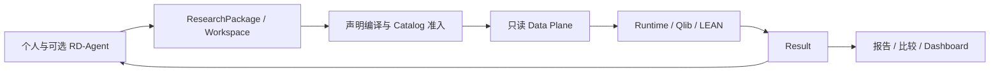

# 模块职责与依赖

QuantWitness 面向个人通过 AI 进行研究。ResearchPackage 冻结问题、输入、算法和范围；application 组织一次准备与准入，runtime 执行，Result 直接交给报告和开发反馈。

## 从问题找到模块

| 问题 | 模块 | 负责的事实 |
| --- | --- | --- |
| 数据是什么、何时可见 | `catalog/` | 字段、来源绑定、可见性与版本 |
| 研究要计算什么 | `packages/` | 研究声明、图编译、指标与输入准入 |
| 怎样读取大表 | `data_plane/` | 只读查询、有界批次和列式工件 |
| 怎样执行与恢复 | `runtime/` | 调度、资源、项目 Worker、事件和检查点 |
| 如何表示市场与账户 | `domain/`、`simulation/` | 时间、规则、订单、资金、持仓与权益 |
| 如何计算特征与训练 | `research/` | 特征、标签、模型、统计与留出消费 |
| 如何交付结果 | `results/` | ResultSpec、原子发布、只读加载与直接消费 |
| 如何生成图表与分析 | 报告及分析模块 | 按显式请求读取 Result 的相关列 |
| 如何接入项目算法 | `extensions/` | 算子 bundle、参数、入口和依赖 |
| 如何连接入口 | `application/` | CLI、Workspace 与 RD-Agent 共用的流程服务 |
| 如何诊断和发现能力 | `cli/`、`operations/`、`platform/` | 参数解析、诊断、公共类型和能力目录 |

## 计算实现的边界

Qlib 提供日频处理器与模型。框架负责训练窗口、标签可见时间、候选选择和持久 holdout 账本。项目分钟策略使用 LEAN，正式输入、策略参数、公司行动和市场规则来自准入计划。

金融约束在读取与状态转换处执行：盘中数据必须已完成，规则必须当时可见，可用资金和可卖数量在订单与账户变更时处理。生产算法通过开发测试验收，完成的研究直接发布 Result。

RD-Agent 位于研究提案层，经正式 Workspace 执行候选并读取开发指标。它不绕过数据准入，也不将最终 test／holdout 用于迭代。失败候选的诊断和成功候选的指标分别表达。

## 正式记录

| 问题 | 记录 |
| --- | --- |
| 当前支持什么 | `capabilities.json` |
| 允许使用哪些来源与时点 | Catalog Lock 和准入计划 |
| 本次研究问题和参数 | ResearchPackage |
| 使用什么实现 | 计划中的算子及项目 bundle |
| 执行到哪里 | 事件、资源观测和已提交 checkpoint |
| 得到了什么 | Result |
| 最终留出数据是否已消费 | 持久研究系列账本 |

同次调用直接交接已经解析的对象。持久计划和检查点用于跨进程执行及恢复；恢复重新检查输入、配置、实现与发布完整性，不能复用陈旧或未提交输出。

## 依赖方向

数据读取集中在 Data Plane，核心算法不导入采集器、数据库兼容 API 或因子发布器。项目代码通过正式接口接入，Dashboard 单向依赖结果接口。受信任的本地项目 Worker 提供进程隔离与资源限制，不是任意 Python 的安全沙箱。

数据库访问只读；输入目录与输出目录分离。采集、修复和因子发布有独立授权要求。数据与实现合同见[数据平面](data_plane.md)、[研究包](research_package.md)、[运行与恢复](runtime.md)及[项目扩展](../EXTENSIONS.md)。
