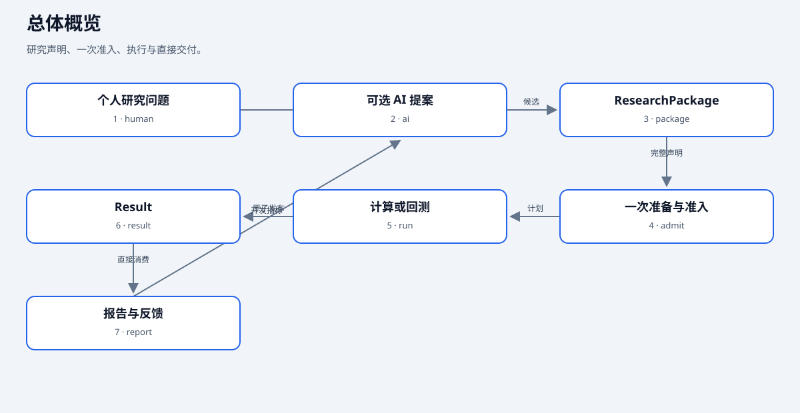

# 六张图，看懂 QuantWitness

README 展示六张简图，点击任一图片直接进入对应的详细交互版。详细版保留完整模块、连接关系、职责说明和状态约定；可以切换浅色/深色主题与视觉风格，开关动态连线，搜索节点并追踪关系。点击节点可高亮，再次点击同一节点取消；空白处也可清除选择。

[](https://ljjtim.github.io/QuantWitness/overview.html)

**在线：** [交互图册](https://ljjtim.github.io/QuantWitness/)。**离线：** 下载源码后用浏览器打开本目录 `index.html`，无需安装 Node 或联网。GitHub 的 HTML 文件页只显示源码，不能代替图册浏览。

| 你想问的问题 | 交互图 | 静态预览 |
| --- | --- | --- |
| 一项研究从想法到交付要经过什么 | [总体概览](overview.html) | [SVG](overview.svg) |
| 14 个核心模块与外部组件怎样协作 | [总体架构](research-pipeline-architecture.html) | [SVG](research-pipeline-architecture.svg) |
| 一项结果能追溯到什么 | [数据追溯](dataflow-research-lineage.html) | [SVG](dataflow-research-lineage.svg) |
| 一次研究该按什么顺序做 | [研究流程](workflow-research-task.html) | [SVG](workflow-research-task.svg) |
| 一次 run 内谁先调用谁 | [调用时序](sequence-research-run.html) | [SVG](sequence-research-run.svg) |
| 中断、失败与成功如何区分 | [运行状态](lifecycle-research-run.html) | [SVG](lifecycle-research-run.svg) |

## 概览与总体架构的区别

总体概览按研究者的任务组织，不展开全部代码模块。总体架构保留 `catalog`、`packages`、`data_plane`、`application`、`runtime`、`research`、`domain`、`simulation`、`results`、`evidence`、`extensions`、`cli`、`operations`、`platform` 共 14 个模块，并标出外部输入、可选 AI 与算法组件。两张图对应不同阅读深度。

## RD-Agent 在哪

RD-Agent 位于研究提案层，接收人的问题与已确认约定，提出候选或生成代码。它通过正式 Workspace 主链执行，只接收成功 Result 的开发指标，最终 test/holdout 不进入反馈。

Qlib 位于计算层，提供模型、处理器和表达式。日线与一分钟策略统一由 LEAN 执行；金融规则、PIT 和资金约束在实际读取与状态转换处检查。算法正确性通过开发期手算、确定性案例及必要差分验收。详细模块职责见[架构与代码边界](../architecture.md)。

## 图的含义与边界

六张图分别描述工作交接、模块职责、数据追溯、研究流程、调用时序和运行状态。节点保留详细说明，源码入口见[source-evidence.json](source-evidence.json)。

- **总体概览：** 人可以直接研究，也可以通过可选 RD-Agent 提案；Result 直接交付报告和开发反馈。
- **总体架构：** 保留14个核心模块和外部组件；应用服务编排运行与结果发布，Qlib 和 LEAN 承担各自计算职责。
- **数据追溯：** 只读来源描述与已保存快照分别记录；只有显式 `--persist-inputs` 才保存查询输入。
- **研究流程：** Workspace execute 一次解析和编译，准备对象直接交给准入与执行；独立 lint 是主动诊断入口。
- **调用时序：** Runtime 调度节点并提交 checkpoint，应用服务发布 Result，消费者通过 ResultContext 读取正式结果。
- **运行状态：** 区分节点执行、Result 发布与报告状态。节点全部成功但 Result 未发布时，resume 只重试组装；报告失败不重跑模型或交易。

历史计划和checkpoint不能跨输入、实现或配置变化复用。最终holdout账本长期保留，失败不能重置已打开区间。具体恢复操作见[运行文档](../runtime.md)。

## 函数与接口定位

| 图中步骤 | 实际入口 | 源码，相对 src/research_pipeline |
| --- | --- | --- |
| Workspace | execute_workspace | application/workspace_flow.py |
| 一次准备与准入 | prepare_package / admit_package | application/research_plan.py |
| 数据来源交接 | execute_operator_graph_data | application/grid_data.py |
| 执行与检查点 | RuntimeExecutionService.execute | runtime/execution_service.py |
| 结果发布 | ResultAssembler | results/assembler.py |
| 直接交付 | load_result_context / ResultContext | results/delivery.py |

## 维护图册

- `sources/*.json`：README 简图的作者文件。
- `sources/detailed/*.json`：详细交互图的作者文件，保留完整的节点、关系和说明卡片。
- `render-previews.mjs`：生成六张简图 SVG 和图册首页。
- `render.mjs`：生成简图，并通过 Archify 3.0.1 生成六张自包含详细 HTML。

浏览图册无需安装依赖或联网。重新生成时，需要 Node 与 Archify 3.0.1；从上游 `tt-a1i/archify` 的 v3.0.1 发布包解压后，在本目录运行（将路径改为自己的安装位置）：

```bash
node render.mjs /path/to/archify
```

只更新某一图使用 `node render.mjs /path/to/archify architecture`；类型还包括 `overview`、`dataflow`、`workflow`、`sequence` 和 `lifecycle`。只更新 README 简图使用 `node render-previews.mjs`。SVG 文字使用微软雅黑常规或粗体。详细 HTML 保留上游交互组件及字体许可，见根目录 `THIRD_PARTY_NOTICES.md`。

修改模块职责或状态约定时，同步更新简图、详细图源、源码依据与渲染结果；两个版本的阅读深度不同，事实口径相同。

## 在 GitHub 上启用在线图册

仓库 Settings → Pages 中选择 **GitHub Actions**，图册变更合入 main 后自动运行 **Architecture pages** 工作流，也可手动触发。工作流只上传六张交互图、SVG 预览及图册首页，不上传本地研究记录、数据或开发目录。

部署地址为 `https://ljjtim.github.io/QuantWitness/`。README 中的图片链接以此为目标；首次启用和成功部署是在线链接可用的前提。发布配置不等于已经完成远端部署。
